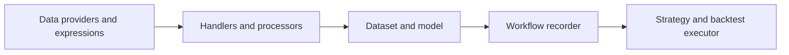
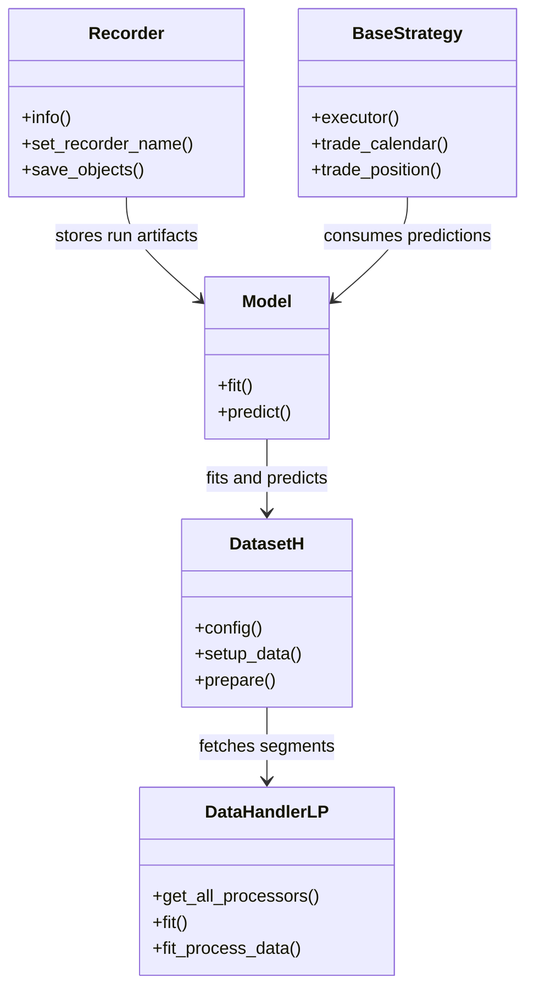
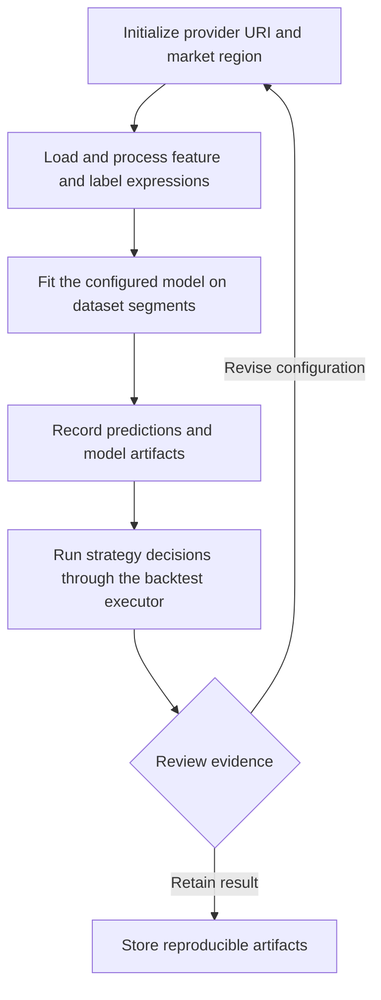
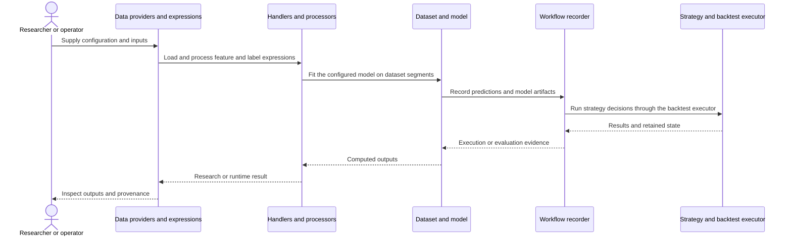
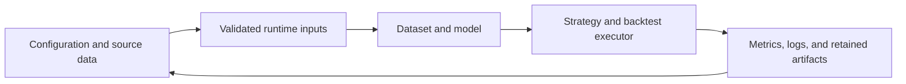
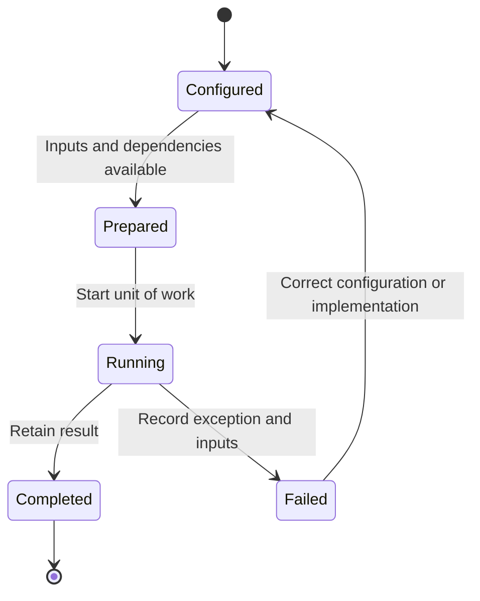

# Qlib: workflow and architecture

Updated 2026-10-12. Source baseline: `54355232463878d2eebb91fe0ee5fa7fa1f5976c` on `feature/ayu_develop`. See [development commands](development.md) and [validation evidence](validation.md) for the tested environment and current limitations.

## Purpose and features

Provides a quantitative research platform that joins market-data access, feature processing, model training, experiment recording, and portfolio backtesting.

- Calendar and instrument-aware market-data providers
- Expression-based features and Cython rolling kernels
- Dataset handlers and processors
- Model training with recorded artifacts
- Strategies, executors, and risk/return evaluation

## Component architecture

Provider, handler, dataset, and model boundaries separate market storage from training code. Handlers distinguish learning and inference processing so label handling and fitted transformations can be controlled. Workflow recorders hold experiment outputs and allow evaluation to refer to a particular run. The backtest layer consumes strategy decisions and applies exchange/executor mechanics, avoiding an implicit equivalence between a predictive score and executable trading returns.

The diagram shows responsibility boundaries in the main research or execution path. Concrete entry points and implementation files are linked below.

## Core types

The types below belong to the public or native boundary described by the linked implementation. Arrows describe the dependency or ownership relationship used in the documented workflow. Listed Python methods are present in the linked source; native array types represent the binding boundary.

## End-to-end workflow

1. Initialize provider URI and market region.
2. Load and process feature and label expressions.
3. Fit the configured model on dataset segments.
4. Record predictions and model artifacts.
5. Run strategy decisions through the backtest executor.

## Interaction sequence

The sequence follows one unit of work. Results return across the same boundaries that accepted the configuration and data. External I/O and numerical execution have different failure modes and should retain separate evidence.

## Data and artifact lifecycle

Inputs include explicit strategy or model settings, data selection, and execution assumptions. Retaining these with outputs makes a rerun reviewable. Temporary environments and caches remain development artifacts, while source-controlled configuration documents intended behavior.

## Execution and failure boundaries

Data fixtures and provider directories are required by integration tests. Redis, MongoDB task management, MLflow storage, and downloadable datasets remain optional service boundaries. Rolling and expanding calculations are compiled C++ extensions generated by Cython, so compiler and NumPy headers are native build requirements.

This state diagram describes the documented workflow, not a claim that these names are an implementation enum. Failure evidence should identify whether input preparation, external services, native compilation, or application execution failed.

## Development layout

The upstream qlib/ Python and Cython layout is retained. setup.py defines native extensions and pyproject.toml defines metadata and build isolation. Moving the package would also require relocating extension paths, so this maintenance updates uv configuration without mass-moving native sources.

## Source map

| Existing source | Responsibility evidence |
|---|---|
| [qlib/__init__.py](../qlib/__init__.py#L25) | Implementation and module/type documentation, beginning at line 25 |
| [qlib/data/data.py](../qlib/data/data.py#L42) | Implementation and module/type documentation, beginning at line 42 |
| [qlib/data/dataset/handler.py](../qlib/data/dataset/handler.py#L25) | Implementation and module/type documentation, beginning at line 25 |
| [qlib/data/dataset/processor.py](../qlib/data/dataset/processor.py#L18) | Implementation and module/type documentation, beginning at line 18 |
| [qlib/data/dataset/__init__.py](../qlib/data/dataset/__init__.py#L15) | Implementation and module/type documentation, beginning at line 15 |
| [qlib/data/_libs/rolling.pyx](../qlib/data/_libs/rolling.pyx#L193) | Implementation and module/type documentation, beginning at line 193 |
| [qlib/data/_libs/expanding.pyx](../qlib/data/_libs/expanding.pyx#L138) | Implementation and module/type documentation, beginning at line 138 |
| [qlib/model/base.py](../qlib/model/base.py#L10) | Implementation and module/type documentation, beginning at line 10 |
| [qlib/model/trainer.py](../qlib/model/trainer.py#L37) | Implementation and module/type documentation, beginning at line 37 |
| [qlib/workflow/recorder.py](../qlib/workflow/recorder.py#L30) | Implementation and module/type documentation, beginning at line 30 |
| [qlib/backtest/executor.py](../qlib/backtest/executor.py#L22) | Implementation and module/type documentation, beginning at line 22 |
| [qlib/strategy/base.py](../qlib/strategy/base.py#L23) | Implementation and module/type documentation, beginning at line 23 |

The links target files present in this checkout. Follow their imports and adjacent tests when changing a boundary. The validation document distinguishes successful builds, complete test runs, inherited skips, and unresolved prerequisites.
