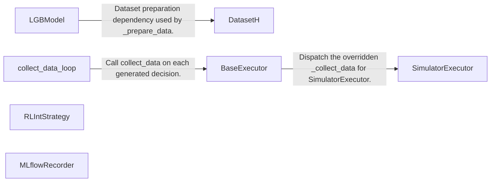
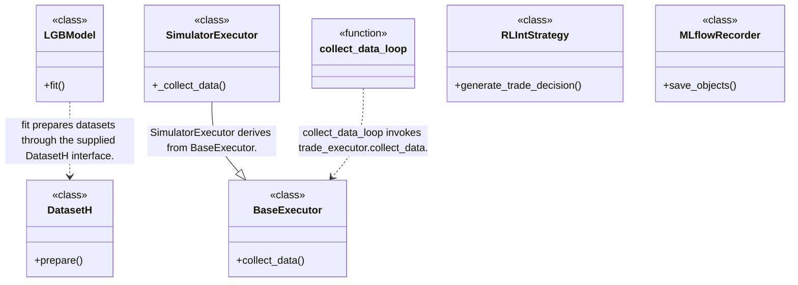
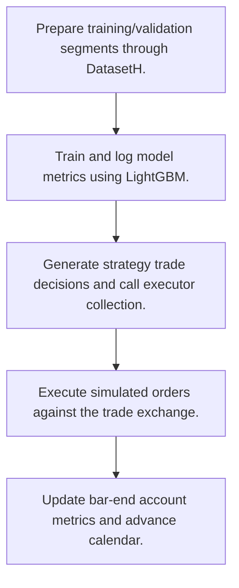
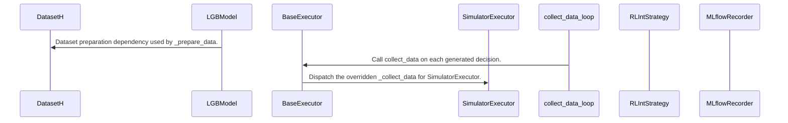

# Qlib: workflow, design and architecture

Updated: **2026-10-13**
Reviewed Git hash: `2d1a897ae444ba6f30be4b867efb56faea83e2e6`
Branch: `feature/ayu_develop`
Source diff SHA256: `e3b0c44298fc1c149afbf4c8996fb92427ae41e4649b934ca495991b7852b855`
Scope: **Machine learning investment research platform** / Maintenance: **active**
Languages: Python

[HTML edition](ayu-develop.html) / [Development](development.md) / [Historical validation](validation.md) / [Full system comparison](../../docs/index.html)

## Purpose and scope

Prepare datasets, train predictive models, track artifacts and simulate strategy decisions at nested execution frequencies.

## Features and support boundaries

Native = implemented here. Integration = supplied through a named host/API. Limited = material restriction. Not provided = evidenced scope exclusion. Unverified = support/absence not established. Not applicable = outside this artifact type.

| Capability | Status | Implementation and limits | Source |
|---|---|---|---|
| Backtesting | Native | Trade decisions flow through SimulatorExecutor and exchange deal_order. | [SimulatorExecutor._collect_data](../qlib/backtest/executor.py) ([L590](https://github.com/alexcwyu/qlib/blob/2d1a897ae444ba6f30be4b867efb56faea83e2e6/qlib/backtest/executor.py#L590)) / [collect_data_loop](../qlib/backtest/backtest.py) ([L52](https://github.com/alexcwyu/qlib/blob/2d1a897ae444ba6f30be4b867efb56faea83e2e6/qlib/backtest/backtest.py#L52)) |
| Live execution | Unverified | The inspected online/model and simulator concepts do not establish a real broker order adapter. | Not applicable to this repository scope. |
| Paper trading | Unverified | The inspected source does not establish this capability. This is not a claim of absence. | Not applicable to this repository scope. |
| Event driven | Native | Generate a decision, execute it, update metrics and advance the calendar sequentially. | [BaseExecutor.collect_data](../qlib/backtest/executor.py) ([L227](https://github.com/alexcwyu/qlib/blob/2d1a897ae444ba6f30be4b867efb56faea83e2e6/qlib/backtest/executor.py#L227)) / [collect_data_loop](../qlib/backtest/backtest.py) ([L52](https://github.com/alexcwyu/qlib/blob/2d1a897ae444ba6f30be4b867efb56faea83e2e6/qlib/backtest/backtest.py#L52)) |
| Vectorized | Unverified | The inspected source does not establish this capability. This is not a claim of absence. | Not applicable to this repository scope. |
| Order management | Native | Order processing and daily dealt-order amount tracking. | [SimulatorExecutor._collect_data](../qlib/backtest/executor.py) ([L590](https://github.com/alexcwyu/qlib/blob/2d1a897ae444ba6f30be4b867efb56faea83e2e6/qlib/backtest/executor.py#L590)) |
| Order types | Limited | Inspected simulator operates Qlib order decisions. This does not establish exchange stop/limit order support. | [SimulatorExecutor._collect_data](../qlib/backtest/executor.py) ([L590](https://github.com/alexcwyu/qlib/blob/2d1a897ae444ba6f30be4b867efb56faea83e2e6/qlib/backtest/executor.py#L590)) |
| Multi venue | Unverified | The inspected source does not establish this capability. This is not a claim of absence. | Not applicable to this repository scope. |
| Crypto | Unverified | The inspected source does not establish this capability. This is not a claim of absence. | Not applicable to this repository scope. |
| Equities | Native | Simulator order volume bookkeeping is keyed by order.stock_id. | [SimulatorExecutor._collect_data](../qlib/backtest/executor.py) ([L590](https://github.com/alexcwyu/qlib/blob/2d1a897ae444ba6f30be4b867efb56faea83e2e6/qlib/backtest/executor.py#L590)) |
| Futures | Unverified | The inspected source does not establish this capability. This is not a claim of absence. | Not applicable to this repository scope. |
| Options | Unverified | The inspected source does not establish this capability. This is not a claim of absence. | Not applicable to this repository scope. |
| Forex | Unverified | The inspected source does not establish this capability. This is not a claim of absence. | Not applicable to this repository scope. |
| Strategy api | Native | generate_trade_decision and post-execution hooks orchestrate strategy behavior. | [collect_data_loop](../qlib/backtest/backtest.py) ([L52](https://github.com/alexcwyu/qlib/blob/2d1a897ae444ba6f30be4b867efb56faea83e2e6/qlib/backtest/backtest.py#L52)) |
| Optimization | Unverified | The inspected source does not establish this capability. This is not a claim of absence. | Not applicable to this repository scope. |
| Machine learning | Integration | Native model abstraction delegates gradient boosting training to LightGBM. | [LGBModel.fit](../qlib/contrib/model/gbdt.py) ([L57](https://github.com/alexcwyu/qlib/blob/2d1a897ae444ba6f30be4b867efb56faea83e2e6/qlib/contrib/model/gbdt.py#L57)) |
| Reinforcement learning | Integration | RLIntStrategy connects state/action interpreters and an externally supplied policy. | [RLIntStrategy.generate_trade_decision](../qlib/strategy/base.py) ([L292](https://github.com/alexcwyu/qlib/blob/2d1a897ae444ba6f30be4b867efb56faea83e2e6/qlib/strategy/base.py#L292)) |
| Portfolio | Native | Executor updates account state and collects portfolio metrics. | [BaseExecutor.collect_data](../qlib/backtest/executor.py) ([L227](https://github.com/alexcwyu/qlib/blob/2d1a897ae444ba6f30be4b867efb56faea83e2e6/qlib/backtest/executor.py#L227)) / [collect_data_loop](../qlib/backtest/backtest.py) ([L52](https://github.com/alexcwyu/qlib/blob/2d1a897ae444ba6f30be4b867efb56faea83e2e6/qlib/backtest/backtest.py#L52)) |
| Risk management | Unverified | The inspected source does not establish this capability. This is not a claim of absence. | Not applicable to this repository scope. |
| Performance analytics | Native | Portfolio and trade indicator metric dictionaries collected by execution frequency. | [collect_data_loop](../qlib/backtest/backtest.py) ([L52](https://github.com/alexcwyu/qlib/blob/2d1a897ae444ba6f30be4b867efb56faea83e2e6/qlib/backtest/backtest.py#L52)) |
| Historical data | Native | DatasetH exposes named historical segments and columns to model pipelines. | [DatasetH.prepare](../qlib/data/dataset/__init__.py) ([L185](https://github.com/alexcwyu/qlib/blob/2d1a897ae444ba6f30be4b867efb56faea83e2e6/qlib/data/dataset/__init__.py#L185)) |
| Streaming data | Unverified | The inspected source does not establish this capability. This is not a claim of absence. | Not applicable to this repository scope. |
| Persistence | Integration | MLflowRecorder serializes and logs experiment artifacts through an MLflow client. | [MLflowRecorder.save_objects](../qlib/workflow/recorder.py) ([L407](https://github.com/alexcwyu/qlib/blob/2d1a897ae444ba6f30be4b867efb56faea83e2e6/qlib/workflow/recorder.py#L407)) |
| Data pipeline | Native | Segment preparation, model fitting and calendar execution boundaries. | [DatasetH.prepare](../qlib/data/dataset/__init__.py) ([L185](https://github.com/alexcwyu/qlib/blob/2d1a897ae444ba6f30be4b867efb56faea83e2e6/qlib/data/dataset/__init__.py#L185)) / [LGBModel.fit](../qlib/contrib/model/gbdt.py) ([L57](https://github.com/alexcwyu/qlib/blob/2d1a897ae444ba6f30be4b867efb56faea83e2e6/qlib/contrib/model/gbdt.py#L57)) / [collect_data_loop](../qlib/backtest/backtest.py) ([L52](https://github.com/alexcwyu/qlib/blob/2d1a897ae444ba6f30be4b867efb56faea83e2e6/qlib/backtest/backtest.py#L52)) |
| Web ui | Unverified | The inspected source does not establish this capability. This is not a claim of absence. | Not applicable to this repository scope. |
| Cli | Unverified | The inspected source does not establish this capability. This is not a claim of absence. | Not applicable to this repository scope. |
| Monitoring | Integration | Model fit logs per-iteration metrics to configured workflow recorder. | [LGBModel.fit](../qlib/contrib/model/gbdt.py) ([L57](https://github.com/alexcwyu/qlib/blob/2d1a897ae444ba6f30be4b867efb56faea83e2e6/qlib/contrib/model/gbdt.py#L57)) |
| Extension api | Native | Executors and strategy hooks plus policy interpreters are replaceable. | [BaseExecutor.collect_data](../qlib/backtest/executor.py) ([L227](https://github.com/alexcwyu/qlib/blob/2d1a897ae444ba6f30be4b867efb56faea83e2e6/qlib/backtest/executor.py#L227)) / [collect_data_loop](../qlib/backtest/backtest.py) ([L52](https://github.com/alexcwyu/qlib/blob/2d1a897ae444ba6f30be4b867efb56faea83e2e6/qlib/backtest/backtest.py#L52)) / [RLIntStrategy.generate_trade_decision](../qlib/strategy/base.py) ([L292](https://github.com/alexcwyu/qlib/blob/2d1a897ae444ba6f30be4b867efb56faea83e2e6/qlib/strategy/base.py#L292)) |
| Native acceleration | Unverified | The inspected source does not establish this capability. This is not a claim of absence. | Not applicable to this repository scope. |
| Distributed execution | Unverified | The inspected source does not establish this capability. This is not a claim of absence. | Not applicable to this repository scope. |

## System components

| Component | Responsibility | Source |
|---|---|---|
| DatasetH | Segmented model dataset access. | [DatasetH.prepare](../qlib/data/dataset/__init__.py) ([L185](https://github.com/alexcwyu/qlib/blob/2d1a897ae444ba6f30be4b867efb56faea83e2e6/qlib/data/dataset/__init__.py#L185)) |
| LGBModel | External LightGBM prediction-model training. | [LGBModel.fit](../qlib/contrib/model/gbdt.py) ([L57](https://github.com/alexcwyu/qlib/blob/2d1a897ae444ba6f30be4b867efb56faea83e2e6/qlib/contrib/model/gbdt.py#L57)) |
| BaseExecutor | Calendar, account metrics and settlement execution lifecycle. | [BaseExecutor.collect_data](../qlib/backtest/executor.py) ([L227](https://github.com/alexcwyu/qlib/blob/2d1a897ae444ba6f30be4b867efb56faea83e2e6/qlib/backtest/executor.py#L227)) |
| SimulatorExecutor | Native simulated order executor. | [SimulatorExecutor._collect_data](../qlib/backtest/executor.py) ([L590](https://github.com/alexcwyu/qlib/blob/2d1a897ae444ba6f30be4b867efb56faea83e2e6/qlib/backtest/executor.py#L590)) |
| collect_data_loop | Strategy-to-executor backtest orchestration. | [collect_data_loop](../qlib/backtest/backtest.py) ([L52](https://github.com/alexcwyu/qlib/blob/2d1a897ae444ba6f30be4b867efb56faea83e2e6/qlib/backtest/backtest.py#L52)) |
| RLIntStrategy | RL state/policy/action adapter. | [RLIntStrategy.generate_trade_decision](../qlib/strategy/base.py) ([L292](https://github.com/alexcwyu/qlib/blob/2d1a897ae444ba6f30be4b867efb56faea83e2e6/qlib/strategy/base.py#L292)) |
| MLflowRecorder | Experiment artifact integration. | [MLflowRecorder.save_objects](../qlib/workflow/recorder.py) ([L407](https://github.com/alexcwyu/qlib/blob/2d1a897ae444ba6f30be4b867efb56faea83e2e6/qlib/workflow/recorder.py#L407)) |

## Architecture and component boundaries

The component view summarizes inspected responsibility boundaries. Arrows identify the documented API/data dependencies; this is not a deployment-readiness claim.

- Dataset preparation dependency used by _prepare_data.: [LGBModel.fit](../qlib/contrib/model/gbdt.py) ([L57](https://github.com/alexcwyu/qlib/blob/2d1a897ae444ba6f30be4b867efb56faea83e2e6/qlib/contrib/model/gbdt.py#L57))
- Call collect_data on each generated decision.: [collect_data_loop](../qlib/backtest/backtest.py) ([L52](https://github.com/alexcwyu/qlib/blob/2d1a897ae444ba6f30be4b867efb56faea83e2e6/qlib/backtest/backtest.py#L52))
- Dispatch the overridden _collect_data for SimulatorExecutor.: [BaseExecutor.collect_data](../qlib/backtest/executor.py) ([L227](https://github.com/alexcwyu/qlib/blob/2d1a897ae444ba6f30be4b867efb56faea83e2e6/qlib/backtest/executor.py#L227)) / [SimulatorExecutor._collect_data](../qlib/backtest/executor.py) ([L590](https://github.com/alexcwyu/qlib/blob/2d1a897ae444ba6f30be4b867efb56faea83e2e6/qlib/backtest/executor.py#L590))

## Design decisions

| Decision | Rationale | Tradeoff | Evidence |
|---|---|---|---|
| Separate strategy decisions from execution frequency and account lifecycle. | BaseExecutor handles bar-end metrics while subclasses implement execution. | Execution realism remains constrained by the simulated exchange/data configuration. | [BaseExecutor.collect_data](../qlib/backtest/executor.py) ([L227](https://github.com/alexcwyu/qlib/blob/2d1a897ae444ba6f30be4b867efb56faea83e2e6/qlib/backtest/executor.py#L227)) / [SimulatorExecutor._collect_data](../qlib/backtest/executor.py) ([L590](https://github.com/alexcwyu/qlib/blob/2d1a897ae444ba6f30be4b867efb56faea83e2e6/qlib/backtest/executor.py#L590)) / [collect_data_loop](../qlib/backtest/backtest.py) ([L52](https://github.com/alexcwyu/qlib/blob/2d1a897ae444ba6f30be4b867efb56faea83e2e6/qlib/backtest/backtest.py#L52)) |
| Track serialized artifacts through MLflow. | Model outputs can be linked to experiments. | Artifact persistence depends on the configured MLflow store. | [MLflowRecorder.save_objects](../qlib/workflow/recorder.py) ([L407](https://github.com/alexcwyu/qlib/blob/2d1a897ae444ba6f30be4b867efb56faea83e2e6/qlib/workflow/recorder.py#L407)) |

## Class and interface relationships

Each node is a reviewed source symbol. Function/module nodes are explicitly labeled; they do not imply Python classes. Only reviewed relationships are drawn.

- **DatasetH** (class): [DatasetH.prepare](../qlib/data/dataset/__init__.py) ([L185](https://github.com/alexcwyu/qlib/blob/2d1a897ae444ba6f30be4b867efb56faea83e2e6/qlib/data/dataset/__init__.py#L185))
- **LGBModel** (class): [LGBModel.fit](../qlib/contrib/model/gbdt.py) ([L57](https://github.com/alexcwyu/qlib/blob/2d1a897ae444ba6f30be4b867efb56faea83e2e6/qlib/contrib/model/gbdt.py#L57))
- **BaseExecutor** (class): [BaseExecutor.collect_data](../qlib/backtest/executor.py) ([L227](https://github.com/alexcwyu/qlib/blob/2d1a897ae444ba6f30be4b867efb56faea83e2e6/qlib/backtest/executor.py#L227))
- **SimulatorExecutor** (class): [SimulatorExecutor._collect_data](../qlib/backtest/executor.py) ([L590](https://github.com/alexcwyu/qlib/blob/2d1a897ae444ba6f30be4b867efb56faea83e2e6/qlib/backtest/executor.py#L590))
- **collect_data_loop** (function): [collect_data_loop](../qlib/backtest/backtest.py) ([L52](https://github.com/alexcwyu/qlib/blob/2d1a897ae444ba6f30be4b867efb56faea83e2e6/qlib/backtest/backtest.py#L52))
- **RLIntStrategy** (class): [RLIntStrategy.generate_trade_decision](../qlib/strategy/base.py) ([L292](https://github.com/alexcwyu/qlib/blob/2d1a897ae444ba6f30be4b867efb56faea83e2e6/qlib/strategy/base.py#L292))
- **MLflowRecorder** (class): [MLflowRecorder.save_objects](../qlib/workflow/recorder.py) ([L407](https://github.com/alexcwyu/qlib/blob/2d1a897ae444ba6f30be4b867efb56faea83e2e6/qlib/workflow/recorder.py#L407))

## Workflow

### Representative source-backed flow

The steps describe the inspected implementation. User configuration and data inputs are external prerequisites.

1. Prepare training/validation segments through DatasetH.. [DatasetH.prepare](../qlib/data/dataset/__init__.py) ([L185](https://github.com/alexcwyu/qlib/blob/2d1a897ae444ba6f30be4b867efb56faea83e2e6/qlib/data/dataset/__init__.py#L185))
2. Train and log model metrics using LightGBM.. [LGBModel.fit](../qlib/contrib/model/gbdt.py) ([L57](https://github.com/alexcwyu/qlib/blob/2d1a897ae444ba6f30be4b867efb56faea83e2e6/qlib/contrib/model/gbdt.py#L57))
3. Generate strategy trade decisions and call executor collection.. [collect_data_loop](../qlib/backtest/backtest.py) ([L52](https://github.com/alexcwyu/qlib/blob/2d1a897ae444ba6f30be4b867efb56faea83e2e6/qlib/backtest/backtest.py#L52))
4. Execute simulated orders against the trade exchange.. [SimulatorExecutor._collect_data](../qlib/backtest/executor.py) ([L590](https://github.com/alexcwyu/qlib/blob/2d1a897ae444ba6f30be4b867efb56faea83e2e6/qlib/backtest/executor.py#L590))
5. Update bar-end account metrics and advance calendar.. [BaseExecutor.collect_data](../qlib/backtest/executor.py) ([L227](https://github.com/alexcwyu/qlib/blob/2d1a897ae444ba6f30be4b867efb56faea83e2e6/qlib/backtest/executor.py#L227))

## Sequence

Representative calls and data dependencies

Messages represent inspected calls or explicitly labelled data dependencies. A data dependency is not an asserted direct runtime call.

- Dataset preparation dependency used by _prepare_data.: [LGBModel.fit](../qlib/contrib/model/gbdt.py) ([L57](https://github.com/alexcwyu/qlib/blob/2d1a897ae444ba6f30be4b867efb56faea83e2e6/qlib/contrib/model/gbdt.py#L57))
- Call collect_data on each generated decision.: [collect_data_loop](../qlib/backtest/backtest.py) ([L52](https://github.com/alexcwyu/qlib/blob/2d1a897ae444ba6f30be4b867efb56faea83e2e6/qlib/backtest/backtest.py#L52))
- Dispatch the overridden _collect_data for SimulatorExecutor.: [BaseExecutor.collect_data](../qlib/backtest/executor.py) ([L227](https://github.com/alexcwyu/qlib/blob/2d1a897ae444ba6f30be4b867efb56faea83e2e6/qlib/backtest/executor.py#L227)) / [SimulatorExecutor._collect_data](../qlib/backtest/executor.py) ([L590](https://github.com/alexcwyu/qlib/blob/2d1a897ae444ba6f30be4b867efb56faea83e2e6/qlib/backtest/executor.py#L590))

## Strengths and limits

### Strengths

- ML training, RL policy adaptation and portfolio execution have separate source-backed boundaries. [LGBModel.fit](../qlib/contrib/model/gbdt.py) ([L57](https://github.com/alexcwyu/qlib/blob/2d1a897ae444ba6f30be4b867efb56faea83e2e6/qlib/contrib/model/gbdt.py#L57)) / [SimulatorExecutor._collect_data](../qlib/backtest/executor.py) ([L590](https://github.com/alexcwyu/qlib/blob/2d1a897ae444ba6f30be4b867efb56faea83e2e6/qlib/backtest/executor.py#L590)) / [RLIntStrategy.generate_trade_decision](../qlib/strategy/base.py) ([L292](https://github.com/alexcwyu/qlib/blob/2d1a897ae444ba6f30be4b867efb56faea83e2e6/qlib/strategy/base.py#L292))

### Limitations

- Simulation and recorded artifacts do not establish live execution or profitable deployment. [SimulatorExecutor._collect_data](../qlib/backtest/executor.py) ([L590](https://github.com/alexcwyu/qlib/blob/2d1a897ae444ba6f30be4b867efb56faea83e2e6/qlib/backtest/executor.py#L590)) / [MLflowRecorder.save_objects](../qlib/workflow/recorder.py) ([L407](https://github.com/alexcwyu/qlib/blob/2d1a897ae444ba6f30be4b867efb56faea83e2e6/qlib/workflow/recorder.py#L407))

## Validation scope

The linked validation and command records preserve actual historical runs and user-authorized exclusions. This source/document review does not rerun application tests, establish live trading readiness or rank benchmark performance. Current data, credential and runtime prerequisites remain material.

[Repository validation](validation.md) / [Executed checks](maintenance/index.md)

## Source map

| Reviewed symbol/path | Inspected responsibility | Actual file SHA256 |
|---|---|---|
| [DatasetH.prepare](../qlib/data/dataset/__init__.py) ([L185](https://github.com/alexcwyu/qlib/blob/2d1a897ae444ba6f30be4b867efb56faea83e2e6/qlib/data/dataset/__init__.py#L185)) | Resolves named segments or segment sequences and delegates to _prepare_seg with selected columns and data key. | `f81de9c050e91e4f25ed0fb802273a7ca7dedc104d580ee30ebdd2a733fc68a8` |
| [LGBModel.fit](../qlib/contrib/model/gbdt.py) ([L57](https://github.com/alexcwyu/qlib/blob/2d1a897ae444ba6f30be4b867efb56faea83e2e6/qlib/contrib/model/gbdt.py#L57)) | Builds LightGBM datasets, configures evaluation/early stopping callbacks, trains and logs iteration metrics. | `a1afddb3bb965d108a916565b57e474cfddc55ce029f781765876e825623ad39` |
| [BaseExecutor.collect_data](../qlib/backtest/executor.py) ([L227](https://github.com/alexcwyu/qlib/blob/2d1a897ae444ba6f30be4b867efb56faea83e2e6/qlib/backtest/executor.py#L227)) | Runs executor-specific collection, updates account metrics at bar end and advances the trade calendar. | `83c2596f569906663c18df6dc48033e57f0a365f706f963d47f6e6301c53ea1c` |
| [SimulatorExecutor._collect_data](../qlib/backtest/executor.py) ([L590](https://github.com/alexcwyu/qlib/blob/2d1a897ae444ba6f30be4b867efb56faea83e2e6/qlib/backtest/executor.py#L590)) | Iterates trade orders, resets daily dealt volume and calls trade_exchange.deal_order, collecting fill/cost/price tuples. | `83c2596f569906663c18df6dc48033e57f0a365f706f963d47f6e6301c53ea1c` |
| [collect_data_loop](../qlib/backtest/backtest.py) ([L52](https://github.com/alexcwyu/qlib/blob/2d1a897ae444ba6f30be4b867efb56faea83e2e6/qlib/backtest/backtest.py#L52)) | Resets executor and strategy, repeatedly generates trade decisions, collects executor results, invokes post-execution hooks and assembles metric dictionaries. | `f792772f81f3c8973f1a91351cda4a8c43fd5bafc791c2b04eabd9e4663cf961` |
| [RLIntStrategy.generate_trade_decision](../qlib/strategy/base.py) ([L292](https://github.com/alexcwyu/qlib/blob/2d1a897ae444ba6f30be4b867efb56faea83e2e6/qlib/strategy/base.py#L292)) | Interprets execution state, calls policy.step and converts the action into a trade decision. | `c141e029bf96b13f6340856ae3ce9a2fae1ee873f9f274b17ba0e639b75baee0` |
| [MLflowRecorder.save_objects](../qlib/workflow/recorder.py) ([L407](https://github.com/alexcwyu/qlib/blob/2d1a897ae444ba6f30be4b867efb56faea83e2e6/qlib/workflow/recorder.py#L407)) | Logs existing artifacts or serializes objects to a temporary directory and uploads them through MLflow client. | `f7ad3d9929c636d07f53b8ed02ff8bfbb64b3b7a0c3b482bb1a2fe390335eb35` |

## Documentation provenance

Review date: 2026-10-13. Full committed source HEAD: `2d1a897ae444ba6f30be4b867efb56faea83e2e6`. Template version: 2. 6 source files were independently hashed for this guide.

[Evidence catalog](../../docs/systems-2026-10-13/catalog.json) / [Standard template](../../docs/guidelines/APP_TEMPLATE.md)

- Snapshot provenance: inventory.json full HEAD 2d1a897ae444ba6f30be4b867efb56faea83e2e6, branch feature/ayu_develop. Source was inspected in the existing checkout and no repository files were changed.
- Inspected implementation bodies and existing architecture documentation. This is a representative static source audit, not a runtime or live-service validation. Credential exclusions in current validation are policy, not evidence that a live connection succeeds.
- Inspected source files: qlib/data/dataset/__init__.py, qlib/contrib/model/gbdt.py, qlib/backtest/executor.py, qlib/backtest/backtest.py, qlib/strategy/base.py, qlib/workflow/recorder.py
